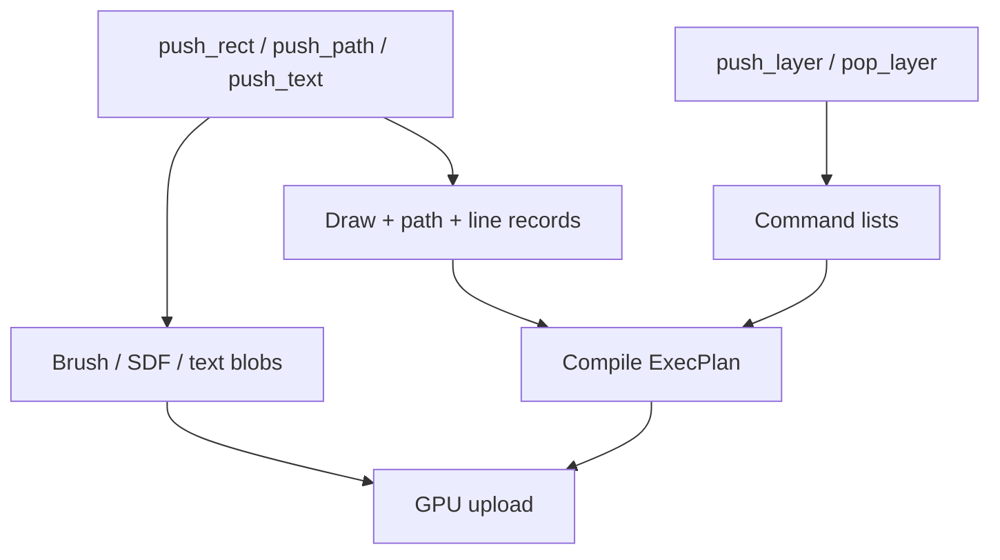

# Immediate Canvas

`Canvas` 是连续的记录容器。每个 `push_*` 写入固定 records、variable blobs 和 command lists；`append`/`append_transformed` 把另一个 Canvas 合并进当前 scene。

## 优势

- 内存连续，完整场景准备和全量渲染吞吐高。
- API 直接，适合导出、测试、小场景和每帧都完全变化的动画。
- `DrawId` 可在 Canvas 生命周期内更新 brush/color，而不必重新构造几何。

## 成本模型

重建 Canvas 通常是 O(总 records + blobs)。如果应用每帧只改变一个节点，但仍重新 append 全场，CPU encode、plan、upload 都会按总场景付费。这正是 `RetainedScene` 解决的问题。

## Layer command tree

`push_clip_*`、`push_opacity_layer`、`push_blend_layer`、`push_filter_layer`、`push_backdrop_layer` 与 `push_mask_layer` 创建嵌套 command lists。每个成功 push 都必须有一个对应 `pop_layer()`；未关闭 Canvas 不能被 append 或插入 retained scene。

编译后的 clip 只进入绘制批次的融合栈。离屏描述只允许 Isolate、Opacity、Blend、Filter 和 Backdrop；只有几何组保存隐藏 draw，Filter／Backdrop 不再保存占位 draw。进入临时表面时，整数边界平移按有符号坐标域饱和，路径坐标先转浮点再取反，避免负原点和极大 clip 导致回绕、内容消失。

记录阶段也只有几何 layer 保存 draw 引用；Filter／Backdrop 只保存 filter 和采样区域，因此参数更新不会触发无关 clip 栈上传。SDF clip 的几何和边界统一保存在场景缓冲中，修改它们可以复用相同的执行拓扑。append 平移消费已取得所有权的 command，避免再次深拷贝 filter 和 mask 描述。

## A backdrop surface with opacity

Use `push_backdrop_layer_with_opacity(filter, region, opacity)` when the backdrop and foreground
belong to the same fading surface. It samples the parent before isolating its foreground, applies
opacity once to the completed surface, and preserves foreground overflow. `pop_layer()` closes it.
Nesting an ordinary backdrop inside an opacity group intentionally samples only that isolated group.
Retained scenes provide the same contract through `RetainedLayerDescriptor::BackdropWithOpacity`.
