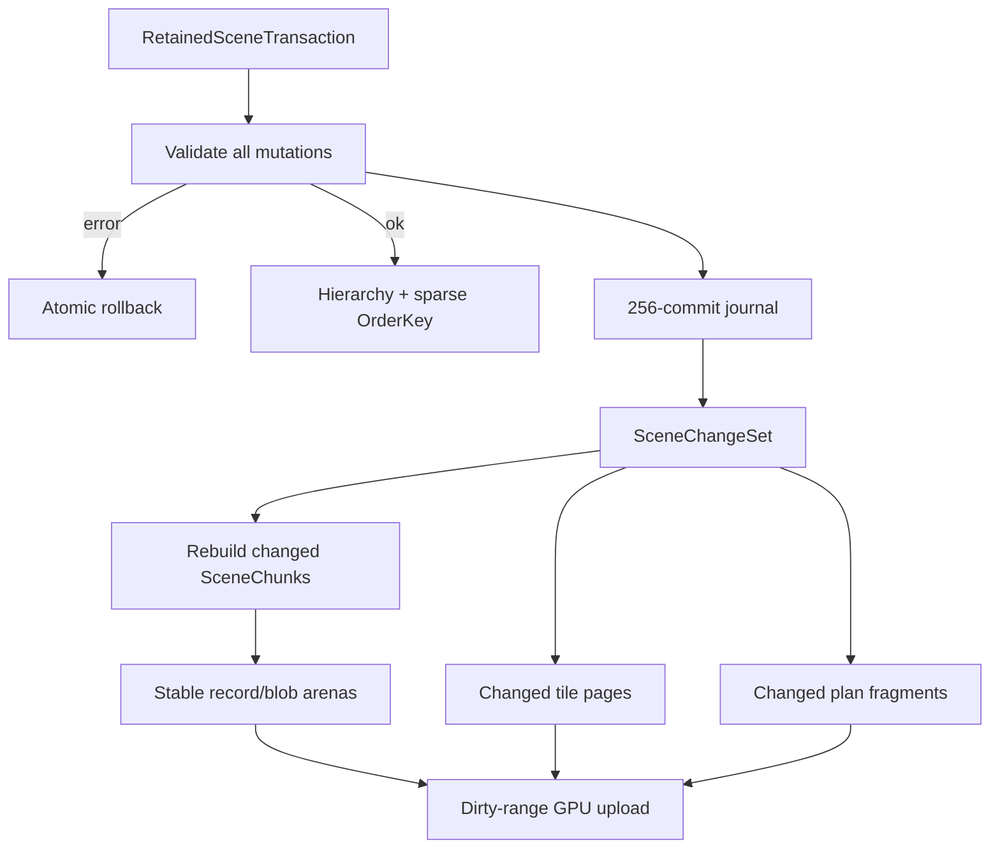

# Retained Scene

`RetainedScene` 是持久、事务式的 scene graph。每个 renderer 独立消费同一 scene 的 change journal，所以多个窗口/设备可以拥有不同 cursor。

## 节点模型

- Scene node：一个不可变 `Rc<Canvas>` 加 `kurbo::Affine` placement。
- Group node：只提供层级与 sibling order。
- Layer node：clip/isolate/opacity/blend/filter/backdrop/mask 语义。
- `RetainedParent` 同时指定 parent node 和 `Content`/`Mask` branch。

Sibling order 使用稀疏 `OrderKey` 和 `BTreeMap`；普通插入/移动为 O(log siblings)，键空间耗尽只 rebalance 当前 parent。

## Transaction 与 journal

`commit()` 先验证重复 ID、缺失 parent、cycle、非法 mask branch、scale mismatch、未关闭 Canvas、非有限/不可逆 transform 和非法尺寸，然后原子应用。成功 commit 推进 `SceneVersion`；内容 generation 由 scene 自动维护。

Journal 保留最近 256 次 commit。renderer 落后超过窗口时做一次 full sync，下一帧恢复增量消费。

## SceneChunk 与稳定 arenas

每个非-group 节点编码成独立 chunk，内部 indices 是 local 的。全局 `SceneArena<T>`/blob arenas 提供稳定 allocation handle：

- transform/content/layer descriptor 变化只重建相关 chunk；
- 删除释放 allocation，不移动其他 chunk；
- 只有 arena allocation 失败且碎片达到阈值时 compaction；
- GPU 仍使用少量全局 storage buffers，不为每个 chunk 创建 bind group。

## 增量 tile 与 plan

Tile draw index 使用 page arena：`Tile → ordered page chain → draw slots`。普通变化只改受影响 tile pages。ExecPlan 缓存 leaf/group/layer fragments；结构变化只沿变化节点到 root 更新。相邻且 layer stack 相同的 fragments 会合并 batch。

Opacity／Blend 包含离屏子层时，在该子树合成完成后应用到整个组。
更新参数会直接修改实际的融合栈或离屏操作，保持 batch 顺序和成员稳定；结果与全新渲染一致。
空组也保留可更新的计划条目。改变层类型时重新编译对应执行结构。

全量编译同时重建每个 leaf 的 batch 分类和 root fragment 的操作范围。
跨多个 batch 的 leaf 不再保留旧的单 batch 分类；随后删除或更新使用当前计划的成员和范围。
普通 leaf 插入只复用其实际绘制位置相邻的执行 batch，不能跨越 clip、filter 等执行边界。
Group 在查找相邻命令时展开；空 layer 的 content 和 mask 分支各自保留独立 batch。

RetainedNodeId 标识可重复使用的逻辑位置，每次重新插入都会创建新的 instance。
内部 NodeRevision 同时包含 instance 与 generation，命令、damage frame 和 surface 缓存使用同一修订身份。
因此同 ID 节点重新从 generation 0 开始时，仍会刷新其像素和离屏缓存。
同 ID 的 Scene／Group 替换直接删除旧命令或插入新命令；journal 过期后的元数据重建也会记录旧实例退役。

根范围复用要求旧 plan 只有一个不带 layer stack 的 batch，且当前 Scene chunk 是普通绘制。
没有背景依赖并不代表执行结构可以复用：Scene 自己也可以包含 clip 或 filter。
跨离屏边界的普通内容按实际相邻 batch 更新，layer 内的移动同时同步权威命令顺序。

嵌套离屏删除只有在整个事务都属于同一存活祖先时才能局部重建。
选择时同时检查旧的已发布树和当前树：移入内容必须删除旧位置的命令，移出内容必须安装到新位置。
祖先本身的父分支和绘制位置也必须保持不变；跨范围修改统一编译当前命令结构。
根 layer 插入需要当前尺寸的空间索引，同事务 resize 会延迟该索引，因此直接编译新结构。
这些规则修复命令遗漏、残留和空间索引越界，保留真正局部修改的 batch 与 draw 存储复用。

根级 fragment 按实际 command scope 索引，Group 内的根级 layer 同样保留所有权。
纯离屏图层重排先验证完整的操作排列，再同步命令位置与 fragment 范围；随后删除仍共享其他子树的 draw 存储。
同事务的参数、类型或依赖 surface 的描述变化需要编译当前结构。
中间插入根图层会同时更新命令顺序和执行顺序，batch 迁移止于下一个 layer 边界。
后续 Scene 自带离屏操作、跨越多个 batch 时，按其完整结构编译。

## Resize fast path

Responsive hierarchy changes committed with a resize preserve the previous immutable frame and
spatial pages. Because the resize invalidates the whole output, those pages are unobservable during
the resize frame; the first later non-resize mutation reconstructs the exact current hierarchy
before incremental damage tracking resumes.

Resize 必须 full redraw，但不等于需要重建场景数据。连续 resize 会：

1. 保留 chunk geometry 和稳定 arenas；
2. 延迟 frame/spatial metadata 重建；
3. 生成一次性的 dense tile bins；
4. resize 结束后的第一次普通增量 mutation 才恢复 persistent reverse index。

这避免每个 resize frame 构造下一帧立刻失效的 per-tile mutation index。
