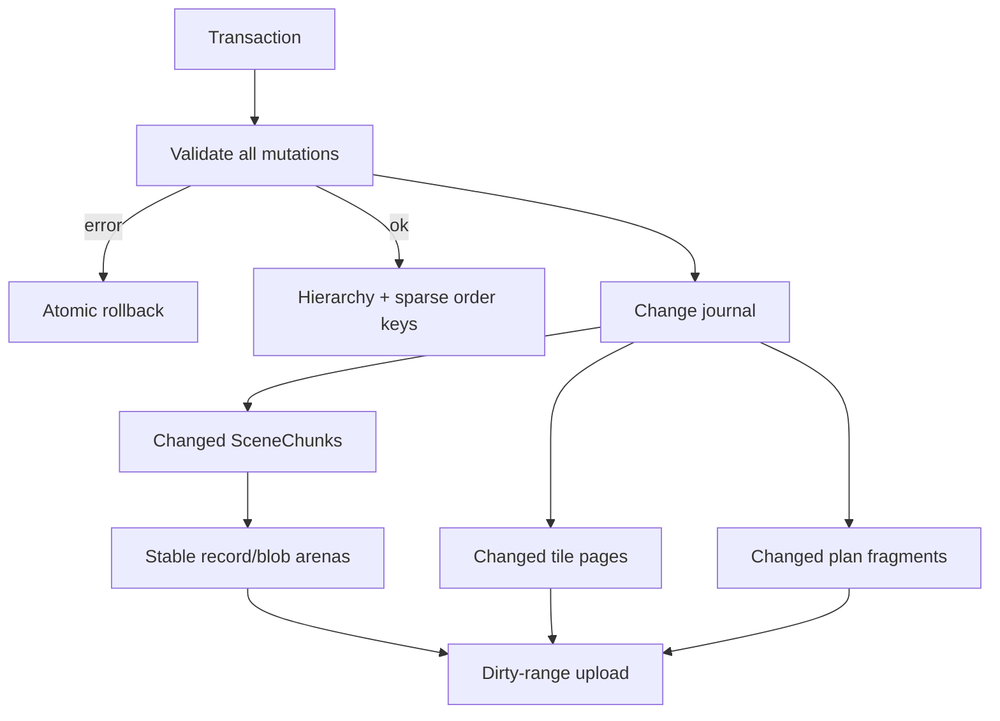

# Retained Scene

`RetainedScene` is a persistent transactional graph. Each renderer consumes its 256-commit change journal independently.

Scene leaves own an immutable `Rc<Canvas>` and a `kurbo::Affine`; groups provide hierarchy; layers provide clip, isolate, opacity, blend, filter, backdrop, or mask semantics. Transactions validate IDs, parents, cycles, mask branches, scale, closed canvases, transforms, and sizes before committing atomically.

Opacity/blend groups containing offscreen children apply to the composited subtree. Parameter
updates patch the actual fused stack or offscreen operation while preserving batch order and
membership, producing the same result as a fresh render. Empty groups retain updateable plan
entries; changing the layer kind recompiles the corresponding execution structure.

Full compilation also replaces leaf batch classifications and root fragment operation ranges.
A leaf spanning several batches retires its old single-batch classification, so later removal
and content updates use the current plan's membership and ranges. Plain leaf insertion reuses
only an execution batch adjacent to its actual painter position; it cannot cross clip or filter
boundaries. Neighbour lookup flattens groups, and empty layer content and mask branches retain
independent batches.

A RetainedNodeId identifies a reusable logical slot; reinsertion creates a new instance.
Internal NodeRevision combines instance and generation in commands, damage frames and
surface-cache metadata. Restarting generation at zero therefore still refreshes the new
instance's pixels and cached surfaces. Scene/Group replacement under the same ID directly
retires or inserts its command. Metadata reconciliation after a journal gap records the
previous instance's retirement too.

Root-wide reuse requires an old plan with one unscoped batch and current plain Scene chunks.
An absence of backdrop dependencies does not establish this structure: a Scene can contain
its own clips or filters. Plain content crossing an offscreen boundary uses its actual
adjacent batch, and moves inside layers also synchronize authoritative command order.

Root fragments follow actual command scope, including root-level layers inside groups.
Pure offscreen reordering validates the complete operation permutation before synchronizing
command locations and fragment ranges; later removal still shares unrelated subtree draw
storage. Parameter, kind, or surface-dependent descriptor changes in the same transaction
compile the current structure. Middle root insertion updates command and execution order
together, and batch migration stops at the next layer boundary. A following Scene spanning
its own offscreen operations requires compilation of its complete structure.

Each non-group node becomes a local-indexed `SceneChunk`. Stable arenas prevent unrelated variable-length updates from moving live data. Tile draw pages and plan fragments update only affected regions/ancestors. During continuous resize, Tileink preserves chunks, defers exact spatial metadata, uses dense one-frame tile bins, and restores the persistent reverse index on the first later incremental mutation. Responsive hierarchy changes committed with a resize also preserve the previous immutable frame/spatial pages because the full redraw makes them unobservable; the first later non-resize mutation reconstructs the exact current hierarchy before incremental damage tracking resumes.
